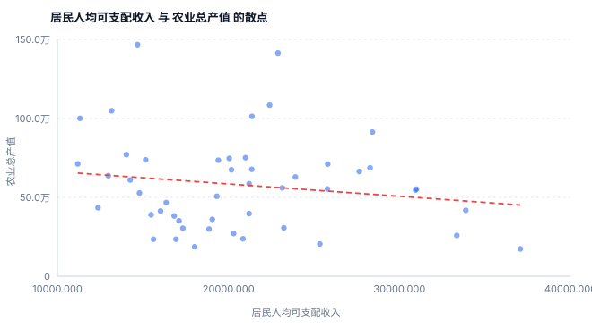

# stat_agent · 经济数据分析 Agent

面向经济统计场景的自然语言数据分析助手：**一句中文问题进去，一份带显著性检验的分析报告出来**。

它不是"让大模型写 SQL 再让它自己解读"的聊天机器人。真正干活的分工是：

| 环节 | 谁来做 | 为什么 |
|---|---|---|
| 听懂问题 | 大模型（或规则） | 自然语言理解是模型擅长的 |
| 写 SQL | 大模型 + 四层校验 | 但字段名、口径、安全边界由代码兜底 |
| 算统计量 | **Python（scipy / statsmodels）** | 数字必须可复现、可验算 |
| 选方法 | **规则路由，模型无权决定** | 相关性用 Pearson 还是 Spearman，看数据不看措辞 |
| 写结论 | 大模型 + 数字白名单 | 报告里每个数字都要能在计算结果里找到出处 |

一句话概括设计取舍：**模型负责"说话"，代码负责"算数"和"守规矩"**。

---

## 一、它解决什么问题

业务方想问的是「贫困县和非贫困县的收入有显著差异吗」，而不是「帮我写一条 SQL」。

传统 BI 要求提问者自己会写 SQL、自己知道该用 t 检验还是方差分析、自己判断 p 值能不能信。这个项目把这三件事都接了过来，并且在**不该给结论的时候明确拒绝**——样本量不够、数据不满足模型前提、问题超出数据范围，都会给出理由而不是硬跑一个模型。

数据是 48 个县 × 9 年（2015–2023）的合成县域经济面板，含 GDP、居民收入、农业总产值、财政支出、常住人口、第二产业占比，以及地形、贫困县标记等维度。合成数据的生成规则、随机种子、口径全部写在 `scripts/generate_data.py` 里，可完全复现。

---

## 二、功能亮点

**1. 统计方法由数据特征决定，不由模型决定**

`core/stats_router.py` 先看数据结构（截面 / 面板 / 时序、样本量、变量类型、缺失率），再决定方法。同一个问题「收入和农业总产值相关吗」，

- 只取 2023 年 → 截面相关（Spearman，n=48）
- 取 2015–2023 全时段 → 面板相关，同时报告 pooled / between / within / 双向去均值四个口径

面板那组数字是这个项目最值得看的地方：

```
pooled          r =  0.0097
between（县际）  r = -0.1444
within（县内）   r =  0.8748   ← 看起来强得离谱
within_two_way  r =  0.0689   ← 剔除年份效应后原形毕露
```

只做个体去均值时相关高达 0.87，再剔除年份共同趋势就掉到 0.07。**如果不分口径，这里会得出一个完全错误的结论**，而且 p 值还会很显著。

**2. 会拒绝建模**

路由层有一组拒绝条件，命中就不跑模型，并在报告里说明原因和建议：

| 场景 | 拒绝码 | 给用户的说法 |
|---|---|---|
| 有效样本 < 30 做相关检验 | `sample_too_small` | p 值不可靠、置信区间宽到没有信息量，建议放宽筛选条件 |
| 分组后每组 < 5 个样本 | `groups_too_small` | 组间检验会失去意义 |
| 时序点 < 8 个 | `too_few_periods` | 不足以识别趋势 |
| 聚类样本 < 20 | `sample_too_small` | 聚类结果不稳定 |
| 问题超出字段范围 | `guard:out_of_scope` | 列出库里有什么、可以怎么问 |
| 要求删改数据 | `guard:write_intent` | 系统只读，没有生成 SQL，也没有读取任何数据 |

**3. 四层 SQL 防线，不靠关键字黑名单**

```
L1 文本层  单条 SELECT、去字符串字面量后数分号、禁用词词边界匹配
L2 引擎层  sqlite3 set_authorizer：只放行 SELECT/READ/FUNCTION，
           READ 的表和列必须在白名单里（连 sqlite_master 都读不到）
L3 连接层  file:...?mode=ro 只读打开
L4 执行层  强制 LIMIT ≤ 5000 + progress_handler 语句级超时
```

字符串黑名单一定漏（注释、大小写、编码变换都能绕），所以真正的边界放在 SQLite 引擎的 authorizer 回调里——那一层拿到的是解析后的表名和列名。

**4. 报告里的数字会被逐个对账**

`core/report_gen.py` 用正则抽出模型报告里的每个数字，去 `stats` 里找得到出处才放行；找不到就整篇丢弃、回退模板报告，并打上 `report:number_mismatch`。允许四舍五入、允许万/亿/百分比的单位换算，但不允许凭空出现一个数。

顺带一个细节：**"显著 / 不显著"这句判定是代码生成的**，附在报告末尾并标注「系统生成，非模型表述」。因为模型措辞会飘——同一份结果，它可能写"未通过显著性检验"，也可能写"不存在显著相关"，而业务方是要据此行动的。

**5. 图表是手写 SVG，零绘图依赖**

`core/charts.py` 直接输出 SVG（直方图、柱状图、折线图、散点图、分组散点）。理由很实际：matplotlib 在服务器上渲染中文需要配字体，缺字体就是一堆方块；SVG 交给浏览器渲染，中文字体直接用客户端的。顺带还省掉了 plotly 那几十兆依赖。

**6. 全链路可观测、可审计**

- 每次提问一个 `trace_id`（`20261106-164a7432e6ee`），日志是 JSON Lines，带阶段与耗时
- 审计写独立库 `data/audit.db`，记录谁、何时、问了什么、跑了什么 SQL、返回几行、是否降级
- 审计记录用 **sha256 哈希链**串起来（每条记录带 `prev_hash`），`python main.py traces` 会校验链是否被改动

**7. 模型不可用时不是报错，而是降级**

没有 API Key、接口超时、返回乱码、SQL 跑不通，都会逐级降级并打标记（`llm:offline`、`sql:llm_failed`、`report:offline` …），用户仍然拿到一份可用的报告。离线模式下意图识别和 SQL 生成走内置规则与模板，整条链路照常跑通。

**8. 历史查询记录：能回看，且回看的是"当时那份"**

每次提问都会往 `data/audit.db` 的 `query_history` 表写一条：时间、问题、意图、执行的 SQL、统计方法、一句话结论摘要、返回行数、耗时、是否降级，以及**完整的报告正文与图表**。

界面右上角切到「历史记录」就是最近 20 条，点任意一条回到当时的现场——不是把问题重跑一遍（数据可能已经变了），而是读回存在库里的那份报告。

```bash
python main.py history                # 最近 20 条
python main.py history --show 42      # 回看第 42 条，图表同时落盘
python main.py history --clear        # 清空（可 --keep N 保留最近 N 条）
```

历史与审计分两张表、各记各的：审计是给合规看的流水（带哈希链，不可改），历史是给人用的书签（可清理）。写历史失败只打一条告警，**不会让一次分析失败**——它是旁路，不是链路的一部分。

**9. Excel 导入：同一套统计链路，换一个数据入口**

网页上把文件拖进虚线框（或点一下选择），确认文件名和大小后点「分析」；命令行则用 `python main.py excel 文件.xlsx`。系统读表、整理列名、识别数值列与分类列，然后**走和数据库查询完全相同的路由与报告逻辑**：同样的方法选择、同样的拒绝规则、同样的图表与"系统生成的统计判定"。

支持 `.xlsx / .xlsm / .xls / .csv`，单文件上限 20 MB，默认读第一个工作表。CSV 会按 utf-8-sig → utf-8 → gbk 依次试编码；没有扩展名时靠文件头判断（zip/OLE 是 Excel，纯文本是 CSV，PDF 这类二进制直接拒绝并提示可用格式）。

```bash
python main.py excel data/raw/county_sample.xlsx
python main.py excel 我的表.xlsx "居民收入和农业总产值有关系吗" --sheet 2023
python main.py excel data/raw/gdp_季度.csv          # CSV 同样走这条路
```

表格脏是常态，所以读取层做了四件事：列名去空白、空列名补成 `列N`、重名列自动去重、**只在该列 90% 以上是数字、且剩下的都是"缺失/NA/—"这类缺失标记时才转数值**。像"待定"这种认得出的文本，宁可整列保留成分类变量，也不静默变成空值——丢样本比丢精度更糟。

读取还有一处平台细节：Windows 上 pandas 的 C 解析器打不开含中文的路径（`OSError: Initializing from file failed`），所以文件一律先读成字节再交给 pandas。这样"从磁盘读"和"从浏览器上传"走的是同一条路，中文文件名也不会出问题。

Excel 通道不生成 SQL，报告里会明写「数据来源：用户上传的表格文件（xxx），未经过数据库查询与 SQL 安全校验」，避免有人把上传数据的结论当成库内数据的结论。

**10. 自动识别：不用先告诉它哪列是时间、哪列是分组**

用户上传的表长什么样都有，不能要求他先改列名。所以读取之后先做一次"认角色"（`core/schema_infer.py`）：

- **时间列**：列名像时间（年/年度/季度/月份/日期/周期/year/date/quarter…）**且取值也像**——数值要落在 1900–2100，文本要以四位年份开头且命中率 ≥80%。只看列名会把"季度评分"当成时间轴，所以我宁可按值再验一遍。`年龄 / 工龄 / 年产量 / 年均` 这类词先排除，避免"年产"被读成"年"。
- **分组列**：县/地区/城市/省/类型/类别/地形/行业…，且 2 ≤ 类别数 ≤ 30、至少两组各有 5 个样本——不满足就只当作文本备注，不硬拿去做方差分析。
- **指标列**：可转数值、不是 id、不是 0/1 二值、缺失不超过 30%。`率 / 占比 / 同比 / 环比 / 增速` 这类派生指标排在水平值后面：表里同时有「生产总值」和「同比增值」时，默认看前者。
- **指标词匹配**：问「居民收入」找 `收入 / income / 人均可支配`，问「GDP」找 `GDP / 生产总值 / 地区生产总值`，问「农业」找 `农业 / 第一产业 / 种植业`。**没点名就不猜**——宁可让结构决定，也不自作聪明挑一列。

然后按结构推荐方法，顺序是：有可用分组 → 分组比较；有 ≥8 期时间 → 时序；≥2 个指标 → 相关；单指标 → 描述统计。每一步推荐的理由都会写进报告的「决策轨迹」，例如「识别数据角色：时间列「周期」：35 个时期」→「检测到分组列「地形」（3 类），默认按它比较「地区生产总值」的组间差异」。

两条边界：**用户说了方法就听用户的**（问"看分布"不会被改成分组比较），只有没提问或那句话完全不含方法词时才由结构接管；面板数据自动做分组比较时**只取最新一期**，理由和 SQL 通道里的年份过滤一样——跨年混算会让 n 虚高、观测不独立，p 值被压小。

---

## 三、一次完整的链路

问题：**「贫困县和非贫困县的收入有显著差异吗」**

```
① 意图识别   group / detected_by=llm
② 生成 SQL   SELECT i.is_poverty_county, e.income
             FROM county_economy e JOIN county_info i ON e.county_id = i.county_id
             WHERE e.income IS NOT NULL
               AND e.year = (SELECT MAX(year) FROM county_economy)
             LIMIT 5000
③ 四层校验   L1 PASS / L2 PASS / 执行 PASS，48 行
④ 结构判定   截面数据，48 个观测，1 个分类变量 + 1 个数值变量
⑤ 方法路由   Shapiro 拒绝正态 → Kruskal-Wallis（而非 ANOVA）
⑥ 计算       H = 5.861，p = 0.0155，epsilon² = 0.106
             非贫困县 22,398.27 元（n=26）/ 贫困县 18,576.61 元（n=22）
⑦ 数字对账   报告中 6 个数字全部可在 stats 中找到出处
⑧ 报告       四节结构 + 系统生成的统计判定 + 局限说明
```

第 ⑤ 步是容易做错的地方：默认跑 ANOVA 也能出 p 值，但前提（正态性、方差齐性）不满足时 p 值没有意义。路由层先做 Shapiro 和 Levene，不满足就换 Kruskal-Wallis，效应量也换成 epsilon²。

---

## 四、快速开始

### 1. 装依赖

```bash
pip install -r requirements.txt
```

Python 3.7+ 即可（开发与测试环境是 3.7.0 / pandas 0.23.4 / numpy 1.15.1 / scipy 1.1.0 / statsmodels 0.9.0）。没有用任何需要编译的包。

### 2. 建库

```bash
python build_db.py          # 顺带做一次数据体检
python build_db.py --check  # 只体检，不重建
```

体检会检查主键重复、每县年份是否齐全、缺失率、人均 GDP 是否落在合理区间、维度表是否有孤儿外键，不通过时返回码非 0。

### 3. 选一个入口

```bash
python main.py                              # 交互式 REPL
python main.py ask "检验各县居民收入和农业总产值是否存在显著相关关系"
python main.py serve --port 8010            # 浏览器打开 http://127.0.0.1:8010
streamlit run app.py                        # Streamlit 界面（需自行 pip install streamlit）
python main.py excel data/raw/county_sample.xlsx   # 分析一张 Excel
python main.py history                      # 最近查询记录
python main.py doctor                       # 体检：数据源、模型、Schema、连通性
python main.py eval                         # 跑 21 条黄金用例
```

三个入口共用同一条 `core/pipeline.answer()`（Excel 通道走 `core/pipeline.answer_frame()`，除了没有 SQL 环节，后面完全一样），`app.py` 和 `web/` 里没有业务逻辑。

### 4. 接入 DeepSeek（可选）

```bash
cp .env.example .env
# 编辑 .env，填 DEEPSEEK_API_KEY
python main.py doctor     # 确认显示「在线（LLM 参与）」
```

**不填也能跑**——没有 Key 时自动进入离线模式，规则与模板接管意图识别和 SQL 生成，统计计算与报告生成不受影响。这是刻意的设计：评审者 clone 下来不需要申请 API Key 就能看到完整效果。

---

## 五、配置

所有配置都能用环境变量覆盖（前缀 `STAT_AGENT_`），不需要改代码。`.env` 只被读取一次（进程启动时），改完要重启。

| 变量 | 默认值 | 说明 |
|---|---|---|
| `DEEPSEEK_API_KEY` | 空 | 留空 = 离线模式 |
| `DEEPSEEK_BASE_URL` | `https://api.deepseek.com` | 兼容 OpenAI 协议的服务均可 |
| `DEEPSEEK_MODEL` | `deepseek-chat` | |
| `STAT_AGENT_TEMPERATURE` | `0.1` | 不是幻觉控制手段；跑回归时设 `0` |
| `STAT_AGENT_PROVIDER` | 自动 | 强制 `deepseek` / `ollama` / `offline` |
| `STAT_AGENT_DB_KIND` | `sqlite` | 另有 `mysql` / `postgres` 适配器（见下方局限） |
| `STAT_AGENT_DB_DSN` | `data/stat_agent.db` | |
| `STAT_AGENT_HOST` / `STAT_AGENT_PORT` | `127.0.0.1` / `8000` | |
| `STAT_AGENT_ALPHA` | `0.05` | 显著性水平 |
| `STAT_AGENT_MIN_N_INFER` | `30` | 低于此样本量不做推断 |
| `STAT_AGENT_SQL_MAX_ROWS` | `5000` | 单次查询返回上限 |
| `STAT_AGENT_RATE_LIMIT_PER_MIN` | `30` | 单会话每分钟提问上限 |

`.env` 已在 `.gitignore` 里，不会被提交。

---

## 六、界面截图

Web 界面（`python main.py serve`）是零依赖的单页应用，没有 CDN、没有外链、没有打包步骤。

建议补三张截图，放在 `docs/images/` 下，README 里用相对路径引用即可：

| 文件名 | 怎么截 | 建议内容 |
|---|---|---|
| `ui-ask.png` | 打开 `http://127.0.0.1:8010` | 首屏：状态徽章（数据源 / 模型 / Schema 校验）+ 提问框 + 示例问题 |
| `ui-report.png` | 提问「贫困县和非贫困县的收入有显著差异吗」 | 结果区：耗时条、图表、"系统生成的统计判定"那一行 |
| `ui-tabs.png` | 同上，切到「SQL 与校验」标签 | 四层校验逐项 PASS 的明细 |
| `ui-history.png` | 右上角切到「历史记录」 | 最近 20 条：#id、时间、意图、一句话结论、方法·行数·耗时 |

也支持用 URL 直接出结果，方便录屏和分享：`http://127.0.0.1:8010/?q=贫困县和非贫困县的收入有显著差异吗`

下面这张是图表模块真实生成的输出（散点图 + 拟合线，纯 SVG）：



命令行下每次回答都会打印 `trace_id`、各阶段耗时和降级标记；图表落盘到 `output/charts/<trace_id>_<n>.svg`，报告落盘到 `output/reports/`。

---

## 七、目录结构

```
stat_agent/
├── main.py                  # CLI：ask / serve / doctor / schema / traces / eval
├── app.py                   # Streamlit 入口（薄壳）
├── build_db.py              # CSV → SQLite + 数据体检
├── core/
│   ├── pipeline.py          # 编排：意图 → SQL → 数据 → 路由 → 计算 → 图表 → 报告
│   ├── intent.py            # 意图识别（模型优先，规则兜底）
│   ├── nlsql.py             # NL2SQL：模型生成 + 模板兜底 + 口径修正
│   ├── datasource/          # 数据源抽象：base / sqlite_source / dbapi_source
│   ├── schema.py            # 表结构自动发现 + 与业务字典的一致性校验
│   ├── stats_router.py      # 统计方法路由（核心，绝不调模型）
│   ├── stats_methods.py     # 统计计算：相关 / 面板 / 分组 / 时序 / 聚类 / 异常
│   ├── data_loader.py       # DataFrame 化、结构判定、清洗（只标记不删样本）
│   ├── analysis.py          # 把路由计划落成计算 + 图表规格
│   ├── charts.py            # 手写 SVG 图表
│   ├── report_gen.py        # 报告生成 + 数字白名单对账
│   ├── audit.py             # 审计（sha256 哈希链）
│   ├── history.py           # 历史查询记录（可回看当时那份报告）
│   ├── excel_io.py          # 读 xlsx / 整理列名 / 数值与分类列识别
│   ├── schema_infer.py      # 认列角色：时间 / 分组 / 指标，并推荐方法
│   ├── llm_client.py        # DeepSeek / Ollama / 离线 三模式客户端
│   ├── logging_setup.py     # trace_id + 结构化日志
│   ├── config.py            # 全部阈值与开关
│   └── env.py               # 极简 .env 解析（不引依赖）
├── prompt/                  # schema 规则 / 统计规范 / 报告规范
├── web/                     # stdlib http.server + 静态前端
├── tests/                   # 冒烟、黄金用例、评估器、探针
├── scripts/                 # 数据生成脚本
└── data/                    # SQLite 库、业务字典、原始 CSV
```

---

## 八、幻觉控制方案

五道闸门，从前到后：

| # | 手段 | 位置 | 拦住什么 |
|---|---|---|---|
| 1 | Schema 绑定 | `core/schema.py` | 编字段、编表名。表结构是运行时 introspect 出来的，不是手写提示词 |
| 2 | SQL 白名单 | `core/datasource/sqlite_source.py` | 越权读写、全表扫描、慢查询 |
| 3 | 计算与解读分离 | `core/stats_methods.py` | 让模型"算"统计量——它算不对，也复现不了 |
| 4 | 统计规范约束 | `prompt/stats_guide.txt` | 相关说成因果、p 值表述错误、把不显著写成"边缘显著" |
| 5 | 数值对账 + 判定由代码生成 | `core/report_gen.py` | 编造数字、措辞漂移 |

另外还有一条流程上的约束：**模型只允许自我修复一次 SQL**。在错误信息上反复迭代，通常会把语法错误改成语义错误——第二次就改对的概率远低于第一次就改对的概率。

---

## 九、可观测与审计

```bash
python main.py traces --limit 20     # 最近的审计记录 + 哈希链校验
python main.py schema                # 运行时生成的表结构提示词（喂给模型的就是它）
python main.py doctor                # 环境体检
```

审计表字段：`ts / trace_id / session_id / actor / question / intent / sql / sql_source / ok / row_count / latency_ms / degraded / error / prev_hash / hash`。

`/api/health`、`/api/metrics` 供监控探活与看板接入。

---

## 十、评估

21 条黄金用例，覆盖七类意图、四种拒绝场景、两条安全用例：

```bash
python main.py eval            # 详细模式
python main.py eval --quiet    # 只输出结论
```

每条用例可以断言意图、方法、拒绝码、行数区间、SQL 片段、统计量（带容差）、报告关键词、降级标记。

当前结果：**21 / 21 通过**（含在线真实调用）。另有冒烟 24 项、路由拒绝 9 项、配置与降级 24 项、界面 10 项、图表 7 项、历史记录 19 项、Excel 通道 27 项、上传通道 29 项、自动识别 30 项。

Excel 那 27 项里有 6 项是真起一个 HTTP 服务、用 multipart 打 `/api/excel` 的：上传、分析、写历史、读历史详情、拒绝非 multipart 请求，一条不落。手写 multipart 比想象中容易错（边界、CRLF、二进制内容），所以这部分不做纯函数测试。

自动识别那 30 项是"给各种怪表"的：季度表（`2018第1季度` 这种文本时间轴）、面板表（年份 + 地形 + 40 个县名）、名字叫「年龄」的数值列（不该被当时间）、列名里带单位的指标（`地区生产总值（万元）`），以及"用户说了分布就别改成分组比较"这类优先级断言。

上传通道那 29 项覆盖的是"文件选不中 / 选进来读不了"这类问题：拖拽区 DOM 与 `accept` 列表、CSV 的中文路径与 GBK 编码、无扩展名时的文件头识别、PDF 被拒时的提示文案、以及带中文文件名的真实 multipart 上传。其中「桌面 CSV 可读」直接读用户桌面上的真实文件，文件不在就跳过——回归测试不该因为别人的机器没有这个文件而红。

数字都是"对着真实输出"写的断言，不是"跑一遍看看"。改代码后跑一次 `eval`，比肉眼检查可靠。

---

## 十一、数据说明

- 48 个县（湖北 24 + 广东 24），2015–2023 共 9 年，432 行；另有一张维度表含地形、贫困县标记、面积
- 县名取自公开行政区划，指标全部**合成**，随机种子 `20240601`，不涉及任何真实统计数据
- 生成时专门设计了三组"有教学价值"的结构：
  - 收入与农业总产值在县内有强共同趋势（within 相关 0.87，双向去均值后 0.07）
  - 贫困县收入显著偏低（p = 0.016），地形差异不显著（p = 0.278）——同一套分组模块既能演示"显著"，也能演示"不显著要说出来"
  - 2023 年注入了 3 个异常县，截面稳健 z + 同比跳变双重佐证才能全部识别（只做截面会漏掉其中一个）
- **贫困县标记是按地形概率生成的合成标签，不是真实名单**。任何"政策效果"类结论都不要引用本仓库数据

---

## 十二、已知局限

- MySQL / PostgreSQL 适配器已写好但**未在真实库上验证过**（本机装不上驱动），默认且唯一验证过的数据源是 SQLite
- 时序预测在 9 个年度点上用对数线性趋势，不是 ARIMA。样本点少于 15 时 ARIMA 的 Hessian 会不收敛，外推结果不可信——这是主动降级，不是遗漏
- 多表关联只支持预置的两张表，没有做通用的 join 推理
- 中文分词用规则匹配，没有接入分词库；问法过于口语化时可能落到模板兜底
- 报告质量依赖模型，但数字和判定不依赖——后者是硬约束

---

## 十三、许可

代码可自由用于学习与二次开发；数据为合成数据，无版权问题。
